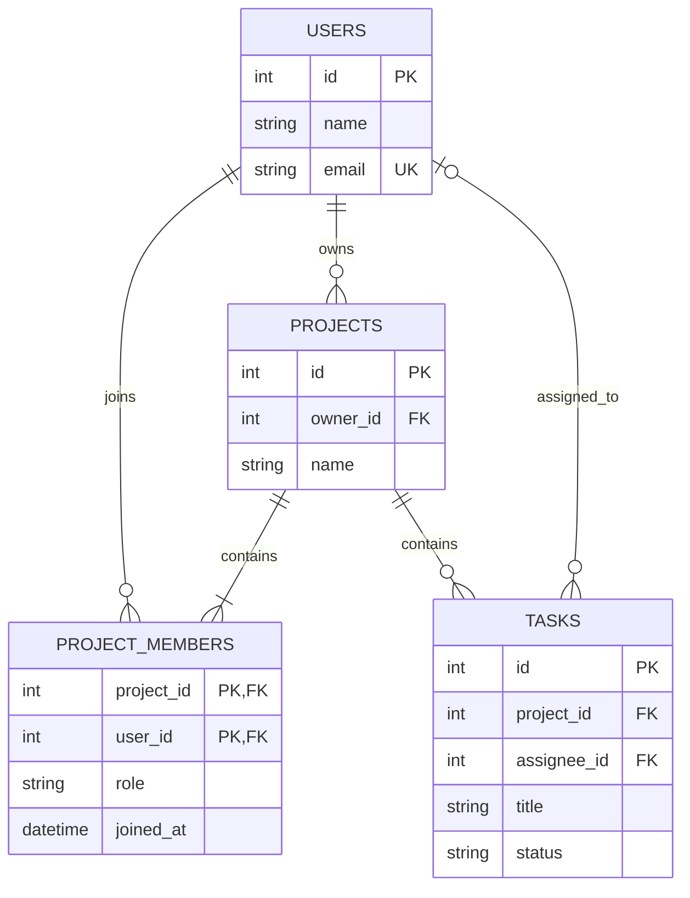

# SQL 基础与数据库设计

从数据如何组织开始，再学习 SQL 如何查询和修改。需求、实体、关系、ER 图、表设计、主外键和范式集中在本篇，不再分散到多份入门文档。

这些内容共同构成关系型数据库与 SQL 的学习基础。示例以 MySQL 8.x / InnoDB 和项目管理系统为背景，建表与实验没有在本机执行。

阅读顺序：需求 → 实体与关系 → ER 图 → 表与字段 → 主外键 → 范式 → SQL 操作。SQL 语法部分也可作为日常速查；索引、事务等后续专题保持独立。

## 一、需求与建模

### 1. 需求：先说清业务，再建表

#### 需求不是页面字段清单

“页面上有项目名称和负责人下拉框”只是界面信息。设计数据库还要知道：项目名是否允许重复？负责人能否变更？负责人是不是项目成员？项目删除后任务怎么处理？

数据库要保存业务事实，不只是把某个页面截图转换成列。

#### 把模糊描述改成用例

以一个简化项目管理系统为例，先约定：

- 用户可以创建多个项目，每个项目有且仅有一个当前负责人。
- 用户可以参与多个项目，一个项目可以有多个成员。
- 创建项目时，负责人必须同时成为项目成员。
- 每个任务属于一个项目；任务可以暂不分配，也可以分配给一名成员。
- 本示例不允许删除仍被项目引用的用户；项目删除先采用受限删除策略。
- 任务状态暂定 todo、doing、done；项目名称允许重复。

这些是教学假设，不是所有产品的固定规则。若真实需求改成“任务可同时分给多人”，后面的表关系就必须改变。

#### 写出查询与修改清单

| 用例 | 输入 | 需要的结果或约束 |
| --- | --- | --- |
| 创建项目 | 创建者 ID、项目名称 | 同时存在项目和 owner 成员 |
| 查询我的项目 | 当前用户 ID、分页条件 | 返回其参与的项目 |
| 查询成员 | 项目 ID、访问者 ID | 先验证资格，再返回成员 |
| 查询任务 | 项目 ID、状态、排序和分页 | 得到稳定排序的任务列表 |
| 分配任务 | 任务 ID、目标成员 ID | 目标人属于该任务所在项目 |

查询清单是后面设计索引的依据。只画实体、不考虑怎么查询，很容易到写接口时才发现缺少字段或合适索引。

#### 单独记录非功能要求

例如数据量增长速度、读写比例、可接受延迟、是否要审计历史、软删除与恢复、个人信息保留期限。

现在不知道准确数字，可以记录假设并说明待验证，不能凭“以后可能很大”就直接分库分表。

**本阶段检查**：能否用具体例子回答重复、缺失、删除、修改、并发时的规则？有争议的地方是否写成假设，而不是暗藏在 SQL 中？

### 2. Entity：什么是实体

Entity 是业务中具有可区分身份、需要跟踪状态或生命周期的对象。

```text
Alice 把名字改成 Alicia
名字变了，但仍是同一个用户
```

这说明用户身份不应该只靠可变姓名判断。

#### 从需求识别候选实体

| 实体 | 为什么独立存在 | 主要属性 |
| --- | --- | --- |
| User | 有独立账户和生命周期 | ID、姓名、邮箱 |
| Project | 可以创建、改名、归档 | ID、名称、负责人、创建时间 |
| Task | 有独立标题、状态和分配过程 | ID、项目、标题、状态、执行人 |
| ProjectMembership | 表达某用户参与某项目的事实 | 项目、用户、角色、加入时间 |

成员关系不仅是两个 ID：角色和加入时间属于“参与这件事”，不属于用户本人，也不属于整个项目。这样带属性的关系往往需要单独建模。

#### 实体、属性、枚举的区别

任务是实体；标题通常是属性；todo / doing / done 是状态取值。不能看到一个名词就建一张表，也不能把所有名词都塞进一个 JSON。

如果状态未来需要自定义顺序、颜色、流转规则，并由管理员维护，它可能发展成独立实体。是否独立取决于业务身份与生命周期。

#### Entity 不等于代码 class，也不立即等于表

概念设计时先关心业务意义。后续可能用一张表表达一个实体，也可能把一个实体的不同部分拆开；实体与数据库表不必机械一一对应。

**本阶段产出**：每个实体的定义、标识候选、属性、生命周期。能解释为什么它独立存在，而不是只列英文名称。

### 3. Relationship：关系、基数与可选性

Relationship 描述实体之间的联系。至少要回答两个维度：最多能关联几个，最少必须关联几个。

#### 一对一、一对多、多对多

| 关系 | 本例含义 | 初步落地方式 |
| --- | --- | --- |
| User → Project | 一人可负责多个项目；项目恰有一位负责人 | projects.owner_id |
| Project → Task | 项目可有零到多个任务；任务恰属一个项目 | tasks.project_id |
| User ↔ Project | 用户可参加多个项目；项目可有多个成员 | project_members 中间表 |
| User → Task | 用户可接多个任务；任务可暂不分配 | tasks.assignee_id 可空 |

“一对多”里的“一”描述上限，不自动说明“至少有一个”。用户尚未创建任何项目也应当是合法用户。

#### 一对一如何表达

如果用户可选填一份个人资料，profiles.user_id 既引用 users.id，又需要 UNIQUE 或直接作为主键，才能阻止同一用户拥有多份资料。只有外键不能保证一对一。

#### 多对多为什么需要中间表

```text
用户 1 → 项目 10、20
用户 2 → 项目 10

project_members：
(10, 1, owner)
(20, 1, member)
(10, 2, member)
```

每行保存一次成员关系，不把项目 ID 拼成 `"10,20"` 放在用户表里。中间表还能记录 role、joined_at。

#### 关系附带的业务约束

“执行人是用户”和“执行人是本项目成员”不是同一个条件。tasks.assignee_id 只引用 users.id，只能检查账户存在，无法自动证明成员资格。

可以按需求选择应用事务校验、组合外键或其他约束设计。先把规则写出来，再讨论由哪一层保证；不要假定一条普通外键覆盖了全部权限。

**本阶段检查**：每条关系的两端是否都有最小/最大数量说明？角色、加入时间放在了正确位置吗？删除父对象时，子对象应保留、阻止删除还是一起删除？

### 4. ER图：把模型放在一张图上检查

ER 是 Entity Relationship，即实体关系。概念 ER 图强调业务对象与联系，逻辑图可以增加属性和键；物理图进一步描述具体表与数据库类型。

下面是本例的逻辑结构示意。FK 标记表示拟采用的外键，不代表已经部署：



读法：`||` 表示恰好一个，`o|` 表示零或一个，`o{` 表示零到多个，`|{` 表示一到多个。

项目端要求至少一名成员，表达了“负责人也必须是成员”的一部分要求。但图中两条关系线本身不能证明 owner_id 就是其中一名成员；还需额外规则与事务保证。

画完图后，用“没有任务的新项目”“暂未分配的任务”“退出项目的成员”“转让负责人的项目”逐个走一遍。图无法表达的条件写成图旁的文字约束。

**本阶段产出**：ER 图、图例、业务规则补充。图是检查工具，不是可以替代全部约束的执行程序。

## 二、表结构、键与范式

### 1. Table：从模型变成表、列与类型

#### 区分表结构与当前数据

表结构定义允许存什么，数据是当前已经保存了什么。users 表可以有一百万行，但结构仍是同一组列与约束。

为每张表先写数据字典：

| 列 | 业务意义 | 可空？ | 设计说明 |
| --- | --- | --- | --- |
| tasks.id | 任务稳定标识 | 否 | 独立主键 |
| tasks.project_id | 所属项目 | 否 | 必须有关联项目 |
| tasks.title | 任务标题 | 否 | 应用校验非空白与长度 |
| tasks.status | 当前任务状态 | 否 | 默认 todo，限制合法取值 |
| tasks.assignee_id | 当前执行人 | 是 | NULL 表示暂未分配 |
| tasks.created_at | 创建时间 | 否 | 统一时间约定 |

#### 类型选择的理由

| 类型 | 常见用途 | 需要考虑的边界 |
| --- | --- | --- |
| INT / BIGINT | ID、数量 | 范围、符号；BIGINT 与 JS 安全整数范围不同 |
| DECIMAL(p,s) | 固定精度金额 | 精度、舍入；驱动可能返回字符串 |
| VARCHAR(n) | 有长度界限的文本 | 字符集、排序规则、业务最大长度 |
| TEXT | 较长正文 | 查询频率、返回体积与索引策略 |
| DATETIME | 日期时间 | 需要约定时区与转换，不能凭类型名假定自动为 UTC |
| JSON | 结构会变化的附属数据 | 不适合代替所有关系、约束和可检索字段 |

BIGINT ID 若可能超出 Number.MAX_SAFE_INTEGER，API 与 Repository 应约定字符串或其他精确表示，不能无条件 Number() 转换。

#### NULL、默认值和空值不同

未分配执行人用 NULL，不要编造 user_id=0。空字符串表示一段长度为零的文本，NULL 表达缺失或未知，两者查询语义不同。

DEFAULT 只决定某些插入场景缺省时的取值，不负责验证所有业务输入。`NOT NULL` 不会自动拒绝空字符串或全空格标题。

#### 示例建表方案

以下是独立教学 schema，需在空的专用学习库中按顺序执行，不覆盖现有项目表；本文没有执行这些语句。

```sql
CREATE TABLE users (
  id INT PRIMARY KEY AUTO_INCREMENT,
  name VARCHAR(100) NOT NULL,
  email VARCHAR(254) NOT NULL,
  created_at DATETIME NOT NULL,
  CONSTRAINT uq_users_email UNIQUE (email)
) ENGINE=InnoDB;

CREATE TABLE projects (
  id INT PRIMARY KEY AUTO_INCREMENT,
  name VARCHAR(200) NOT NULL,
  owner_id INT NOT NULL,
  created_at DATETIME NOT NULL,
  CONSTRAINT fk_projects_owner FOREIGN KEY (owner_id)
    REFERENCES users(id) ON DELETE RESTRICT
) ENGINE=InnoDB;

CREATE TABLE project_members (
  project_id INT NOT NULL,
  user_id INT NOT NULL,
  role VARCHAR(20) NOT NULL,
  joined_at DATETIME NOT NULL,
  PRIMARY KEY (project_id, user_id),
  CONSTRAINT chk_member_role CHECK (role IN ('owner', 'member')),
  CONSTRAINT fk_members_project FOREIGN KEY (project_id)
    REFERENCES projects(id) ON DELETE RESTRICT,
  CONSTRAINT fk_members_user FOREIGN KEY (user_id)
    REFERENCES users(id) ON DELETE RESTRICT
) ENGINE=InnoDB;

CREATE TABLE tasks (
  id INT PRIMARY KEY AUTO_INCREMENT,
  project_id INT NOT NULL,
  title VARCHAR(200) NOT NULL,
  status VARCHAR(20) NOT NULL DEFAULT 'todo',
  assignee_id INT NULL,
  created_at DATETIME NOT NULL,
  CONSTRAINT chk_task_status CHECK (status IN ('todo', 'doing', 'done')),
  CONSTRAINT fk_tasks_project FOREIGN KEY (project_id)
    REFERENCES projects(id) ON DELETE RESTRICT,
  CONSTRAINT fk_tasks_assignee FOREIGN KEY (assignee_id)
    REFERENCES users(id) ON DELETE RESTRICT
) ENGINE=InnoDB;
```

本例将创建时间显式交给写入逻辑，并约定统一使用 UTC。库和连接的字符集、排序规则应在运行环境中明确设置；邮箱是否忽略大小写要结合业务归一化规则与列排序规则决定。

CHECK 的实际执行要求 MySQL 8.0.16 及以上。这份建表方案没有保证“项目恰有一个 role=owner 成员”“执行人属于该项目”等跨行规则，后面通过业务设计继续处理。

类型和约束语法见 [MySQL CREATE TABLE](https://dev.mysql.com/doc/refman/8.4/en/create-table.html)。

### 2. PK/FK：标识、唯一性与引用完整性

#### 主键、候选键、唯一约束

主键是选定的行标识，唯一且非空。一张表可以有多个候选键：每个候选键都是能够唯一标识记录的最小属性组合。

例如“邮箱必填且业务上唯一”成立时，邮箱可以是候选键。选择 id 作主键后，邮箱仍应通过 UNIQUE 保持其业务唯一性。

| 概念 | 例子 | 解决的问题 |
| --- | --- | --- |
| 自然键 | 受业务规则约束的唯一邮箱 | 用业务属性识别 |
| 代理键 | 自增 id | 稳定、简洁的技术标识 |
| 联合主键 | (project_id, user_id) | 唯一标识一次成员关系 |
| 唯一约束 | UNIQUE(email) | 防止业务重复 |

如果给成员表新增自增 id，仍需要 UNIQUE(project_id, user_id)，否则两个不同 id 仍可能代表重复成员关系。

#### 外键保证什么

projects.owner_id 引用 users.id，表示每个非空 owner_id 都必须有对应用户。父子列类型需要兼容，整数的大小与符号等要匹配，索引要求也要满足。

外键不自动证明“当前请求者有权设置这个负责人”。引用完整性和业务权限要分别实现。

#### 删除策略

| 策略 | 含义 | 适用判断 |
| --- | --- | --- |
| RESTRICT | 有依赖时阻止父记录删除 | 要求显式处理关联数据 |
| CASCADE | 父记录删除时自动删除依赖行 | 子记录生命周期确实从属于父对象 |
| SET NULL | 删除父记录后把子列设为 NULL | 关联允许缺失，列本身必须可空 |

不要给所有外键统一套 CASCADE。成员关系消失后是否需要保留操作历史，是需求问题。

InnoDB 外键检查通常立即进行，不能按“先插入不存在的引用，提交时才检查”设计执行顺序。[MySQL 外键约束](https://dev.mysql.com/doc/refman/8.4/en/create-table-foreign-keys.html)

#### 更强的关联约束

若要用数据库限制“执行人属于该项目”，可以研究让 `(project_id, assignee_id)` 引用成员表的 `(project_id, user_id)`。但执行人可空、成员退出、历史任务保留和索引要求都要一起设计。

这属于可选择的增强方案，不是本例已部署的约束。不要只增加一个组合外键，就忽略退出成员后任务应该如何处理。

**本阶段检查**：有无稳定主键？重复业务记录由什么阻止？外键失败如何向业务反馈？删除策略是否与数据保留要求一致？

### 3. 邮箱唯一索引的约束范围

`UNIQUE(email)` 只要求邮箱不重复；InnoDB 二级索引记录携带主键，是为了定位用户行，不代表主键参与 email 的唯一性规则。

`UNIQUE(id, email)` 只限制组合重复，无法阻止不同 ID 的用户使用相同邮箱。唯一性判断也受字段排序规则影响。


### 4. 范式：避免把同一事实存得到处都是

范式是检查关系结构的规则，主要帮助发现冗余和插入、更新、删除异常。它不是“表拆得越多越好”。

#### 先理解函数依赖

`X → Y` 表示在业务允许的数据中，确定 X 就能确定 Y。

```text
user_id → user_name
project_id → project_name
(project_id, user_id) → role
```

依赖来自规则，不是碰巧当前两行数据没重复。成员角色通常依赖“哪个用户在哪个项目”，不能只由 user_id 决定。

#### 第一范式 1NF：属性值按所选业务语义保持单值

需要独立查询和约束的多个成员，不应作为逗号分隔列表挤在 members 字段里：

```text
projects：id=10, member_ids="1,2,3"
```

否则判断成员、去重和外键检查都难以可靠完成。改用成员关系表，每行表示一对项目和用户。

属性值的原子性依赖模型的使用语义。一个地址字符串含逗号，并不因有逗号就违反 1NF；问题在于把多个需要独立处理的同类事实压成一个值。合法的 JSON 类型也不自动证明整体建模合理。

#### 第二范式 2NF：非主属性不只依赖候选键的一部分

考虑下表，以 (project_id, user_id) 为候选键：

| project_id | user_id | project_name | user_name | role |
| --- | --- | --- | --- | --- |
| 10 | 1 | 网站重构 | Alice | owner |
| 10 | 2 | 网站重构 | Bob | member |

project_name 只依赖 project_id；user_name 只依赖 user_id；role 才依赖完整组合。

把项目名称放回 projects、用户名称放回 users，成员表只保存关系事实，就能避免改一个项目名时更新所有成员行。

这里的“主属性”指属于至少一个候选键的属性。讨论 2NF 要看所有候选键，不能只看选中的主键；加一个单列自增 id 并不会自动消除业务依赖和重复事实。

#### 第三范式 3NF：进一步检查传递依赖

假设有部门业务，且每个用户属于一个部门：

```text
users(user_id, user_name, department_id, department_name)

user_id → department_id → department_name
```

部门名称是部门的事实，不应该在每个用户行里重复维护。拆成 users 和 departments 后，用户只保存 department_id。

入门可先理解为“非键事实不通过另一个非键事实间接依赖身份”。更正式地，对每个非平凡函数依赖 X→A，3NF 要求 X 是超键，或 A 是主属性；BCNF 则要求决定因素 X 都是超键。

普通项目先掌握 1NF～3NF，遇到复杂依赖再深入 BCNF，不必先背所有高阶范式名称。

#### 为什么要规范化

| 异常 | 例子 |
| --- | --- |
| 更新异常 | 同一个部门名重复十次，改名漏掉一行 |
| 插入异常 | 想先创建部门，却必须先有一个用户才能保存部门信息 |
| 删除异常 | 删除最后一个用户，连唯一的部门信息也消失 |

“更新用户名称”与“保留订单成交时的姓名快照”是不同语义。历史快照可能刻意冗余，并不应该跟随用户改名。要明确它是历史事实还是可重建缓存，再讨论规范化。

规范化基础可参考 [Microsoft 的入门说明](https://learn.microsoft.com/en-us/previous-versions/troubleshoot/microsoft-365/microsoft-365-apps/access/database-normalization-description)；本文的项目、成员、部门例子用于串联依赖分析。

**本阶段产出**：主要函数依赖、拆分理由、保留冗余的原因及同步方式。不是只写“符合第三范式”一句话。

## 三、SQL 语法与操作

本部分沿用原 project_management SQL 练习的数据和字段约定，具体以本部分的示例数据说明为准；它与前面的概念建表示例分别阅读，不要将不同示例的字段直接混用。

### 1. SQL是什么

SQL：

Structured Query Language

结构化查询语言。

用于操作数据库。

主要分为：

#### 查询

SELECT

例如：

``` sql
SELECT *
FROM users;
```

#### 插入

INSERT

例如：

``` sql
INSERT INTO users(username)
VALUES('Tom');
```

#### 修改

UPDATE

例如：

``` sql
UPDATE users
SET username='Jack'
WHERE id=1;
```

#### 删除

DELETE

例如：

``` sql
DELETE FROM users
WHERE id=1;
```

------------------------------------------------------------------------

### 2. 示例数据与安全说明

你当前的数据库是 `project_management`，其中包括：

```text
project_management
├── users
├── projects
├── project_members
└── tasks
```

从实际操作记录可以确认，`tasks` 至少包含这些字段：

| 字段 | 示例含义 |
| --- | --- |
| `id` | 任务 ID |
| `project_id` | 所属项目 ID |
| `creator_id` | 创建者用户 ID |
| `title` | 任务标题 |
| `status` | 状态数值 |
| `priority` | 优先级数值 |
| `created_at` | 创建时间 |

**注意**：下面的 `tasks` 查询可以针对你的现有数据执行；涉及新增、修改、删除的示例优先使用独立练习表 `sql_practice_tasks`，避免把现有近百万条数据误改掉。`status` 的数字代表什么业务状态，必须以你自己的项目约定为准。

可先执行以下 SQL 创建练习表（不会修改 `tasks`）：

```sql
USE project_management;

CREATE TABLE IF NOT EXISTS sql_practice_tasks (
    id BIGINT UNSIGNED NOT NULL AUTO_INCREMENT,
    project_id BIGINT UNSIGNED NOT NULL,
    title VARCHAR(200) NOT NULL,
    status TINYINT UNSIGNED NOT NULL DEFAULT 0,
    priority TINYINT UNSIGNED NOT NULL DEFAULT 0,
    created_at DATETIME NOT NULL DEFAULT CURRENT_TIMESTAMP,
    PRIMARY KEY (id)
);
```

---

### 3. SQL 语句分类与基本规则

| 分类 | 常见命令 | 用途 |
| --- | --- | --- |
| DQL（查询） | `SELECT` | 读取数据 |
| DML（数据操作） | `INSERT`、`UPDATE`、`DELETE` | 新增、修改、删除数据 |
| DDL（结构定义） | `CREATE`、`ALTER`、`DROP`、`TRUNCATE` | 管理数据库对象或表结构 |
| TCL（事务控制） | `START TRANSACTION`、`COMMIT`、`ROLLBACK` | 控制事务 |
| DCL（权限控制） | `GRANT`、`REVOKE` | 用户权限管理 |

常见规则：

- SQL 通常以 `;` 结束。
- 关键字不区分大小写，推荐使用大写便于阅读。
- 字符串使用单引号，例如 `'task_1'`；标识符需要引用时使用反引号，例如 `` `status` ``。
- `-- `（后面有空格）和 `#` 可写单行注释；`/* ... */` 可写块注释。
- 不能用 `= NULL` 比较空值，应使用 `IS NULL`。
- MySQL 的 `LIMIT` 语法与部分其他数据库不同，本文以 **MySQL** 为准。

```sql
-- 一行注释
SELECT * FROM tasks LIMIT 10;

/* 多行注释
   用于说明查询目的 */
SELECT COUNT(*) FROM tasks;
```

---

### 4. 数据库和表的查看

#### 查看与切换数据库

```sql
SHOW DATABASES;

USE project_management;

SELECT DATABASE();    -- 当前所选数据库
SELECT VERSION();     -- MySQL 版本
```

也可以直接写完整名称，不依赖 `USE`：

```sql
SELECT *
FROM project_management.tasks
LIMIT 10;
```

#### 查看表、字段、建表语句

```sql
SHOW TABLES;

DESCRIBE tasks;
-- 或：
SHOW COLUMNS FROM tasks;

SHOW CREATE TABLE tasks;
```

#### 查看已有索引

```sql
SHOW INDEX FROM tasks;
```

重点看：`Key_name`（索引名称）、`Column_name`（对应字段）、`Seq_in_index`（联合索引中的字段顺序）。

#### 查看会话与自动提交状态

```sql
SELECT @@autocommit;
SHOW FULL PROCESSLIST;
```

`@@autocommit = 1` 通常表示非显式事务中的 DML 每条语句执行成功后自动提交。`SHOW FULL PROCESSLIST` 可以用来排查长时间运行的语句。

---

### 5. SELECT：查询数据

#### 查询所有字段

```sql
SELECT *
FROM tasks
LIMIT 20;
```

`*` 表示全部字段。接口开发中更建议明确写需要的字段。

#### 查询指定字段

```sql
SELECT id, project_id, title, status
FROM tasks
LIMIT 20;
```

#### 使用字段别名和表别名

```sql
SELECT
    t.id AS task_id,
    t.title AS task_title,
    t.status
FROM tasks AS t
LIMIT 20;
```

`AS` 可省略，但建议初学时写清楚。

#### 去重

```sql
SELECT DISTINCT status
FROM tasks;
```

获取出现过的不同状态值，而不是返回每一条任务。

---

### 6. WHERE：条件筛选

#### 比较运算

```sql
-- 等于
SELECT * FROM tasks WHERE project_id = 100 LIMIT 20;

-- 不等于（<> 是标准写法，MySQL 也支持 !=）
SELECT * FROM tasks WHERE status <> 1 LIMIT 20;

-- 大于 / 小于 / 大于等于 / 小于等于
SELECT * FROM tasks WHERE priority >= 3 LIMIT 20;
```

| 运算符 | 含义 |
| --- | --- |
| `=` | 等于 |
| `<>`、`!=` | 不等于 |
| `>`、`<` | 大于、小于 |
| `>=`、`<=` | 大于等于、小于等于 |
| `AND` | 同时满足 |
| `OR` | 任一条件满足 |
| `NOT` | 条件取反 |

#### 多条件组合

```sql
SELECT id, title, status, priority
FROM tasks
WHERE project_id = 100
  AND status = 1
  AND priority >= 3;
```

`AND` 与 `OR` 混合时使用括号，避免误解优先级：

```sql
SELECT *
FROM tasks
WHERE project_id = 100
  AND (status = 1 OR status = 2)
LIMIT 20;
```

#### IN / NOT IN

```sql
SELECT *
FROM tasks
WHERE status IN (0, 1, 2)
LIMIT 20;

SELECT *
FROM tasks
WHERE status NOT IN (0, 1)
LIMIT 20;
```

注意：集合中如果包含 `NULL`，`NOT IN` 可能产生与直觉不同的结果；复杂查询优先确认空值情况。

#### BETWEEN

```sql
SELECT *
FROM tasks
WHERE priority BETWEEN 2 AND 4
LIMIT 20;
```

`BETWEEN` **包含两个边界值**。

#### LIKE：模糊匹配

```sql
-- 以 task_ 开头（下划线在 LIKE 中是单字符通配符，
-- 此写法仅作宽泛匹配示例）
SELECT * FROM tasks WHERE title LIKE 'task%' LIMIT 20;

-- 包含关键字
SELECT * FROM tasks WHERE title LIKE '%123%' LIMIT 20;
```

- `%`：匹配任意长度的字符（包括零个）。
- `_`：匹配任意一个字符。
- `LIKE '%关键字%'` 这类前置通配符查询，普通 B+Tree 索引往往难以高效利用。

#### NULL 判断

```sql
SELECT * FROM tasks WHERE title IS NULL;
SELECT * FROM tasks WHERE title IS NOT NULL;
```

`NULL` 表示缺失/未知，不等于 `0`，也不等于空字符串 `''`。

#### 时间区间查询

```sql
SELECT id, title, created_at
FROM tasks
WHERE created_at >= '2026-10-01 00:00:00'
  AND created_at <  '2026-11-01 00:00:00';
```

建议用左闭右开区间 `>= 起始 AND < 下月起始`，避免漏掉一天内带有时间部分的数据。

---

### 7. ORDER BY / LIMIT：排序与分页

#### 升序、降序

```sql
-- 最新任务在前
SELECT id, title, created_at
FROM tasks
ORDER BY created_at DESC, id DESC
LIMIT 20;

-- 优先级从低到高
SELECT id, title, priority
FROM tasks
ORDER BY priority ASC, id ASC
LIMIT 20;
```

- `ASC`：升序（默认）。
- `DESC`：降序。
- 多个排序字段可使排序更稳定，例如时间相同时再按 `id` 排序。

#### 分页

```sql
-- 第 1 页，每页 20 条
SELECT * FROM tasks ORDER BY id LIMIT 20 OFFSET 0;

-- 第 2 页，每页 20 条
SELECT * FROM tasks ORDER BY id LIMIT 20 OFFSET 20;

-- MySQL 另一种写法：LIMIT 偏移量, 行数
SELECT * FROM tasks ORDER BY id LIMIT 20, 20;
```

页码与偏移量的关系：`OFFSET = (页码 - 1) × 每页条数`。

**重要**：一定要配合 `ORDER BY`；否则“第一页”和“第二页”的记录顺序不可靠。大偏移量分页也可能越来越慢。

#### 游标式分页（大数据量常用）

```sql
SELECT id, title
FROM tasks
WHERE id > 100000
ORDER BY id
LIMIT 20;
```

用于“下一页”时只需记住上一页最后一条 `id`，但这种方式不适合任意跳转到第 N 页。

---

### 8. 聚合函数、GROUP BY 和 HAVING

#### COUNT / SUM / AVG / MIN / MAX

```sql
-- 任务总数
SELECT COUNT(*) AS task_count FROM tasks;

-- 各种优先级的统计值（示例）
SELECT
    COUNT(*) AS total_tasks,
    SUM(priority) AS priority_sum,
    AVG(priority) AS priority_avg,
    MIN(priority) AS min_priority,
    MAX(priority) AS max_priority
FROM tasks;
```

区别：

- `COUNT(*)`：计数所有行。
- `COUNT(字段)`：只统计该字段非 `NULL` 的行。
- `COUNT(DISTINCT 字段)`：统计不同非空值的数量。

```sql
SELECT COUNT(DISTINCT project_id) AS project_count
FROM tasks;
```

#### GROUP BY：按状态统计

```sql
SELECT status, COUNT(*) AS task_count
FROM tasks
GROUP BY status
ORDER BY status;
```

**核心概念**：先按 `status` 分组，再对每一组计算数量。

#### 分组后筛选 HAVING

```sql
SELECT project_id, COUNT(*) AS task_count
FROM tasks
WHERE status = 1
GROUP BY project_id
HAVING COUNT(*) >= 100
ORDER BY task_count DESC
LIMIT 20;
```

- `WHERE`：**分组前**筛选行。
- `HAVING`：**分组后**筛选组。

这个查询表示：统计每个项目中状态为 `1` 的任务，仅保留数量至少 100 的项目。

---

### 9. JOIN：多表关联查询

> 以下示例假定 `projects` 存在 `id`、`name` 字段；如果你的实际表结构不同，先运行 `DESCRIBE projects;` 查看后调整。

#### INNER JOIN：两表都匹配才返回

```sql
SELECT
    t.id AS task_id,
    t.title,
    p.name AS project_name
FROM tasks AS t
INNER JOIN projects AS p
    ON t.project_id = p.id
WHERE t.status = 1
LIMIT 20;
```

可以理解为：通过 `tasks.project_id = projects.id` 找到任务所属项目。

#### LEFT JOIN：保留左表记录

```sql
SELECT
    p.id AS project_id,
    p.name,
    t.id AS task_id,
    t.title
FROM projects AS p
LEFT JOIN tasks AS t
    ON t.project_id = p.id
WHERE p.id = 100;
```

即使项目没有任务，项目本身仍会出现在结果中，此时任务字段为 `NULL`。

#### 用中间表查询多对多关系

```sql
-- 查询用户 ID = 10 参与的项目 ID
SELECT pm.project_id, pm.user_id
FROM project_members AS pm
WHERE pm.user_id = 10;
```

```sql
-- 如果要拿到项目名称，再关联 projects
SELECT p.id, p.name
FROM project_members AS pm
JOIN projects AS p
    ON p.id = pm.project_id
WHERE pm.user_id = 10;
```

**注意**：一对多 JOIN 可能让项目行重复出现，这是关联结果的正常现象，不等于数据库出现重复数据。

---

### 10. INSERT：新增数据

为避免修改实际 `tasks`，下面使用 `sql_practice_tasks`。

#### 插入一条

```sql
INSERT INTO sql_practice_tasks (project_id, title, status, priority)
VALUES (100, '学习 INSERT', 0, 2);
```

#### 一次插入多条（比循环逐条执行更高效）

```sql
INSERT INTO sql_practice_tasks (project_id, title, status, priority)
VALUES
    (100, '任务 A', 0, 1),
    (100, '任务 B', 1, 3),
    (101, '任务 C', 2, 4);
```

#### 默认值与自动增长 ID

未写入 `id` 时由 `AUTO_INCREMENT` 分配；未写入 `created_at` 时使用 `CURRENT_TIMESTAMP` 默认值。

```sql
SELECT LAST_INSERT_ID();
```

`LAST_INSERT_ID()` 可获取**当前连接**最近一次相关自增插入产生的 ID；应用中使用连接池时要注意连接归属。

#### 插入前检查约束

实际业务中，唯一索引、外键、`NOT NULL` 等约束可能让 INSERT 失败，这是数据库保护数据一致性的正常机制。

---

### 11. UPDATE：修改数据

#### 按 ID 修改

```sql
UPDATE sql_practice_tasks
SET status = 1
WHERE id = 1;
```

#### 同时修改多个字段

```sql
UPDATE sql_practice_tasks
SET title = '更新后的任务',
    status = 2,
    priority = 4
WHERE id = 1;
```

#### 修改前先查询

```sql
SELECT * FROM sql_practice_tasks WHERE id = 1;
```

**危险写法**：

```sql
-- 不要对真实业务表随便执行！
-- UPDATE tasks SET status = 2;
```

没有 `WHERE` 时，会更新整张表；但也要注意 `WHERE` 写错仍可能误更新很多行。生产修改前应确认影响范围，并视场景使用事务和备份。

---

### 12. DELETE / TRUNCATE：删除数据

#### DELETE 指定记录

```sql
DELETE FROM sql_practice_tasks
WHERE id = 1;
```

#### 删除符合条件的练习记录

```sql
DELETE FROM sql_practice_tasks
WHERE status = 2;
```

删除前先运行相同条件的 `SELECT`：

```sql
SELECT * FROM sql_practice_tasks WHERE status = 2;
```

#### DELETE 和 TRUNCATE 的区别

| 操作 | `DELETE FROM 表` | `TRUNCATE TABLE 表` |
| --- | --- | --- |
| 删除范围 | 可按 `WHERE` 删除 | 清空整表 |
| 命令分类 | DML | MySQL 中属于 DDL |
| InnoDB 显式事务 | 通常可以回滚 | 会隐式提交，不能像普通 DELETE 一样回滚 |
| 自增计数 | 通常不重置 | 通常重置 |
| 外键限制 | 按约束检查 | 被外键引用时可能不允许执行 |

```sql
-- 仅对你不再需要的独立练习表操作：
-- TRUNCATE TABLE sql_practice_tasks;
```

**警告**：不要对已有近百万条任务的 `tasks` 表运行 `TRUNCATE`，除非明确要清空且已做好数据备份。

---

### 13. CREATE / ALTER / DROP：表结构管理

#### 创建数据库

```sql
CREATE DATABASE IF NOT EXISTS demo_database
CHARACTER SET utf8mb4;
```

#### 创建表

本笔记开头已创建 `sql_practice_tasks`。下面是结构定义的常用元素：

```sql
CREATE TABLE IF NOT EXISTS demo_categories (
    id BIGINT UNSIGNED NOT NULL AUTO_INCREMENT,
    name VARCHAR(100) NOT NULL,
    created_at DATETIME NOT NULL DEFAULT CURRENT_TIMESTAMP,
    PRIMARY KEY (id),
    UNIQUE KEY uk_category_name (name)
);
```

- `NOT NULL`：不允许 `NULL`。
- `DEFAULT`：默认值。
- `AUTO_INCREMENT`：自增。
- `PRIMARY KEY`：主键。
- `UNIQUE KEY`：唯一性约束/索引。

#### 增加字段

```sql
ALTER TABLE sql_practice_tasks
ADD COLUMN remark VARCHAR(200) NULL;
```

#### 修改字段类型或重命名

```sql
ALTER TABLE sql_practice_tasks
MODIFY COLUMN remark VARCHAR(500) NULL;

ALTER TABLE sql_practice_tasks
RENAME COLUMN remark TO description;
```

修改列名或类型前要检查后端代码、索引和依赖，实际项目应记录为 Migration，而不是仅在 Workbench 手工改线上表。

#### 删除列、表

```sql
-- 危险操作；仅演示语法：
-- ALTER TABLE sql_practice_tasks DROP COLUMN description;
-- DROP TABLE IF EXISTS demo_categories;
```

`DROP TABLE` 会删除表结构和表中数据。DDL 在 MySQL 中通常触发隐式提交，不能假设包进事务就一定能回滚。

---

### 14. 子查询、CTE 与常用函数

#### 子查询

```sql
-- 找到任务数量大于 500 的项目 ID
SELECT project_id, COUNT(*) AS task_count
FROM tasks
GROUP BY project_id
HAVING COUNT(*) > 500;
```

也可以把子查询放在 `IN` 中：

```sql
SELECT id, title, project_id
FROM tasks
WHERE project_id IN (
    SELECT project_id
    FROM tasks
    GROUP BY project_id
    HAVING COUNT(*) > 500
)
LIMIT 20;
```

这种写法仅用于演示子查询，实际大数据场景可能需要优化。

#### CTE：WITH 临时命名查询结果

```sql
WITH task_stats AS (
    SELECT project_id, COUNT(*) AS task_count
    FROM tasks
    GROUP BY project_id
)
SELECT project_id, task_count
FROM task_stats
WHERE task_count > 500
ORDER BY task_count DESC
LIMIT 20;
```

CTE 让复杂 SQL 更易读；不等于数据库一定会先生成一个永久表。

#### 常见函数

```sql
-- 当前日期时间
SELECT NOW(), CURDATE(), CURTIME();

-- 日期格式化
SELECT DATE_FORMAT(NOW(), '%Y-%m-%d %H:%i:%s');

-- 当值为 NULL 时使用默认值
SELECT COALESCE(NULL, '默认文本');

-- 字符串拼接
SELECT CONCAT('task_', 100);

-- 四舍五入
SELECT ROUND(3.14159, 2);
```

注意：对索引列直接包裹某些函数可能影响索引的高效使用，例如 `WHERE DATE(created_at) = '2026-10-13'` 通常不如使用原字段的时间范围判断。

---

### 15. 常见错误与安全提醒

| 现象 | 原因 | 处理 |
| --- | --- | --- |
| `ERROR 1046 No database selected` | 没有选中数据库 | `USE project_management;` 或写完整库名 |
| 查询结果只显示 1000 行 | Workbench 常见的结果限制 | 查看 GUI 行数限制；需要时显式使用 `LIMIT` |
| `Unknown column` | 字段名错误或不在当前查询作用域 | `DESCRIBE 表名;` |
| `Duplicate entry` | 违反唯一索引或主键 | 检查主键和唯一键 |
| 外键插入失败 | 被引用记录不存在或字段定义不匹配 | 检查 FK 与关联数据 |
| `key = NULL` | 当前执行计划未使用索引 | 结合 `EXPLAIN` 检查原因，不要立即盲目建索引 |
| MySQL 执行很久 | 查询、锁等待或逐行插入效率低 | 查看执行计划、批量操作、检查事务或进程列表 |
| UPDATE/DELETE 影响行数异常 | `WHERE` 缺失或条件错误 | 先 `SELECT` 验证，必要时使用事务 |

#### 长时间运行查询的排查

```sql
SHOW FULL PROCESSLIST;
```

如果确认需要取消某个会话正在运行的查询，可以从**另一个连接**中执行：

```sql
-- 替换为实际查到的连接 ID；不要盲目执行
-- KILL QUERY 12345;
```

`KILL QUERY` 通常只取消正在运行的语句，不会撤销之前已经自动提交成功的 INSERT；这也是此前批量生成测试数据时需要注意的地方。

---

### 16. 动手练习：10 道 SQL 小题

建议自己先写 SQL，再对照相应章节。前 8 题全部只读，不会修改数据。

1. 查询 `tasks` 中前 20 条任务的 `id`、`title`、`status`。
2. 查询 `project_id = 100` 且 `status = 1` 的任务。
3. 将某项目任务按 `created_at` 从新到旧排序。
4. 统计每个 `status` 对应的任务数量。
5. 找出任务数量超过 1000 的项目 ID。
6. 查询状态为 `1`、优先级至少 `3` 的任务前 20 条。
7. 使用 `JOIN` 查询任务标题及所属项目名称（先确认 `projects.name` 存在）。
8. 对 `WHERE project_id = 100` 执行 `EXPLAIN` 和 `EXPLAIN ANALYZE`，观察 `key`、预计行数、实际耗时。
9. 在 `sql_practice_tasks` 插入三条不同状态的练习任务，再查询检查结果。
10. 开启事务，修改练习任务状态，查询确认后执行 `ROLLBACK`，检查是否恢复。

---

### 17. 一页速查表

| 想做什么 | 常用语句 |
| --- | --- |
| 切换数据库 | `USE project_management;` |
| 查看所有表 | `SHOW TABLES;` |
| 看表结构 | `DESCRIBE tasks;` |
| 看建表 SQL | `SHOW CREATE TABLE tasks;` |
| 查询数据 | `SELECT ... FROM ...;` |
| 按条件筛选 | `WHERE ...` |
| 多条件 | `AND / OR / IN / BETWEEN / LIKE` |
| 空值判断 | `IS NULL / IS NOT NULL` |
| 排序 | `ORDER BY ... ASC/DESC` |
| 分页 | `LIMIT 20 OFFSET 40` |
| 去重 | `DISTINCT` |
| 统计总数 | `COUNT(*)` |
| 分组 | `GROUP BY` |
| 筛选分组结果 | `HAVING` |
| 关联其他表 | `JOIN ... ON ...` |
| 插入 | `INSERT INTO ... VALUES ...` |
| 修改 | `UPDATE ... SET ... WHERE ...` |
| 删除行 | `DELETE FROM ... WHERE ...` |
| 新建表 | `CREATE TABLE ...` |
| 增改字段 | `ALTER TABLE ...` |
| 看索引 | `SHOW INDEX FROM ...` |
| 建索引 | `CREATE INDEX ... ON ...` |
| 查看预计执行计划 | `EXPLAIN SELECT ...` |
| 测量真实查询执行 | `EXPLAIN ANALYZE SELECT ...` |
| 排除指定索引 | `IGNORE INDEX (...)` |
| 开始事务 | `START TRANSACTION;` |
| 提交事务 | `COMMIT;` |
| 回滚事务 | `ROLLBACK;` |
| 查看运行中的语句 | `SHOW FULL PROCESSLIST;` |

---

## 四、学习自检

先解释一个项目的实体、关系和约束，再画 ER 图、写表结构；最后用 INSERT、SELECT、JOIN、UPDATE、DELETE 操作示例数据。能说明主键为什么稳定、外键检查什么、范式解决哪类重复问题，以及条件写错会如何影响数据。

索引与 EXPLAIN 见 [[20-后端/数据库/03-索引]]，事务见 [[20-后端/数据库/04-事务]]，Node 数据访问见 [[20-后端/数据库/57-Repository数据访问]]。

## 阅读导航

上一篇：[[20-后端/数据库/01-数据库基础]]。

下一篇：[[20-后端/数据库/03-索引]]。

返回 [[20-后端/数据库/00-数据库学习导航]]。
