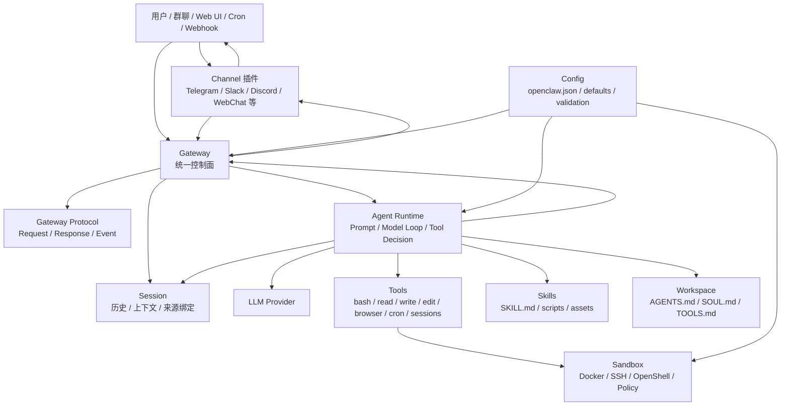

# OpenClaw 核心架构深度分析

> 说明：本文基于 OpenClaw 仓库中的 `README.md`、`docs/**`、`src/**`、`packages/**`、`extensions/**`、`package.json`、`pnpm-workspace.yaml` 等源码和文档整理。凡是源码或文档中没有明确表达、但根据结构推导得到的结论，均标注为“推测”。

## 1. OpenClaw 的定位

OpenClaw 最准确的定位不是“聊天机器人”，也不是简单的 “LLM API wrapper”，而是一个本地优先的个人 AI 助手运行时。

README 明确称它是一个运行在你自己设备上的 personal AI assistant，能够接入已有聊天渠道、语音设备、Canvas，并通过 Gateway 作为控制面统一管理会话、渠道、工具和事件，见 `README.md:21`、`README.md:22`、`README.md:161`。

### 1.1 它不是简单 ChatBot

普通 ChatBot 的核心通常是：用户输入 -> LLM -> 文本回复。

OpenClaw 的核心链路更复杂：

```text
外部消息 / Web UI / Cron / Webhook
-> Gateway 网关
-> Channel（通道） / Session（上下文会话） / Agent（智能体）
-> Model（大模型） + Tools（工具） + Skills（技能） + Workspace（工作区）
-> Sandbox（沙箱） / Permission（权限）
-> 回写 Session（上下文会话）
-> 通过 Channel 或 UI 返回
```

因此它具有聊天机器人的入口，但架构目标不是“聊天”，而是让 AI 能长期运行、读写工作区、使用工具、处理自动化任务，并跨渠道响应用户。

### 1.2 它不是单纯 Agent 框架

CrewAI、AutoGen 这类框架更像 agent 编排库。OpenClaw 则是一个完整运行时，包含：

- Gateway 控制面
- Channel 插件系统
- Agent runtime
- Session 存储
- Tool 系统
- Skill 系统
- Workspace 管理
- Config 校验
- Sandbox 隔离
- Cron/Webhook 自动化
- UI/App/Node 接入

所以它不仅能“编排 agent”，还负责 agent 在真实用户环境中长期、安全、可配置地运行。

### 1.3 和 Claude Code / Cursor 的区别

Claude Code 和 Cursor 更聚焦代码编辑、命令行开发或 IDE 内体验。

OpenClaw 更像“可以接入 Telegram/Slack/Discord/WebChat 等渠道的个人助理运行时”。它可以做开发任务，但开发只是其中一个场景；它也可以做定时报告、消息处理、自动化运维、跨设备协作。

### 1.4 适合场景

- 个人长期 AI 助手
- 多渠道 AI 助手，例如 Telegram、Slack、Discord、WebChat
- 开发辅助 agent
- 自动化巡检、日报、PR 总结
- 团队内部的受控 agent bot
- 带工具权限和沙箱隔离的 AI 工作流

### 1.5 不适合场景

- 只想做一个极简 LLM 聊天页面
- 不需要长期 session、workspace、tools、channels 的轻量项目
- 对外部消息完全开放、但又不准备做权限控制的场景
- 希望 agent 无监督自动执行高风险操作的场景

## 2. 总体分层架构



### 2.1 分层表

| 层 | 主要职责 | 输入 | 输出 | 关键源码 |
|---|---|---|---|---|
| CLI / Startup | 启动 Gateway、dev/build/test 脚本 | 命令行、配置 | Gateway 进程、构建产物 | `package.json:1434`、`package.json:1533` |
| Gateway | 统一控制面，管理 agents/channels/sessions/tools/events | WebSocket、Channel、Cron、Webhook | agent turn、channel reply、events | `src/gateway/server.ts:24`、`src/gateway/server.impl.ts:540` |
| Gateway Protocol | RPC frame、事件、schema | request/event payload | typed frame | `packages/gateway-protocol/src/schema/frames.ts:138` |
| Channel | 外部聊天渠道适配 | Telegram/Slack/Discord 消息 | 内部 normalized message | `src/gateway/server.impl.ts:845`、`extensions/slack/src/channel.ts:539` |
| Agent | 运行模型循环、上下文和工具决策 | session + prompt + tools | final answer / tool call | `src/agents/agent-command.ts:1718` |
| Session | 保存历史、分支、compact、reset、来源关系 | agent turn、tool result、model output | JSONL/metadata | `src/agents/sessions/session-manager.ts:32` |
| Tool | 提供模型可调用能力 | tool call | tool result | `src/tools/protocol.ts:9`、`src/agents/sessions/tools/index.ts:106` |
| Skill | 封装任务工作流说明 | skill trigger | agent instructions/scripts | `docs/tools/skills.md:11`、`src/agents/system-prompt.ts:270` |
| Workspace | agent 的长期工作区和提示词文件 | files/config | AGENTS/SOUL/TOOLS/skills | `README.md:271`、`src/agents/workspace.ts:26` |
| Config | 配置加载、默认值、校验、扩展 | openclaw config | runtime config | `src/config/validation.ts:878`、`src/config/zod-schema.ts:768` |
| Sandbox | 工具执行隔离和权限控制 | tool request | allowed/blocked execution | `docs/gateway/sandboxing.md:9`、`src/agents/sandbox/types.ts:71` |
| Cron/Webhook | 主动自动化入口 | schedule/http payload | agent turn/delivery | `docs/automation/cron-jobs.md:11`、`src/cron/types.ts:293` |

## 3. Gateway 深入

Gateway 是 OpenClaw 的核心控制面。

官方文档：[Gateway 网关架构 - OpenClaw](https://docs.openclaw.ai/zh-CN/concepts/architecture)

> 配图缺失：原笔记引用旧电脑的 Typora 图片，文件未包含在笔记仓库中。原路径：`C:\Users\djct\AppData\Roaming\Typora\typora-user-images\image-20260602143947700.png`。

文档说明，一个长驻 Gateway 进程拥有 messaging surfaces，并通过 WebSocket 给客户端提供连接，见 `docs/concepts/architecture.md:10`、`docs/concepts/architecture.md:13`。Gateway 不是普通后端 API，它统一管理：

agent 请求：让 AI 干活
chat/session：保存上下文
channel runtime：接外部消息平台
cron/webhook：不用人聊天也能触发任务
gateway events：把运行过程实时广播出去
tool/catalog/status：告诉 Agent 有什么工具能用、现在能不能用
node/device/pairing：管理哪些设备/节点能连进来并暴露能力

源码入口：

- `src/gateway/server.ts:24`：导出 `startGatewayServer`，懒加载实现。
- `src/gateway/server.impl.ts:540`：Gateway server 主实现入口。
- `src/gateway/server.impl.ts:845`：创建 channel manager。
- `src/gateway/server.impl.ts:1019`：加载 channel plugin runtime 信息。
- `src/gateway/server.impl.ts:1170`：挂载 plugin gateway handlers。
- `packages/gateway-protocol/src/schema/frames.ts:138`：Gateway request/response/event frame schema。

### 3.1 Gateway 消息路径

```text
Channel 收到外部消息
-> Gateway channel runtime
-> Gateway agent method 解析 request/channel/session
-> Session manager 读取或创建 session
-> Agent runtime 执行
-> Agent final answer
-> Gateway delivery 解析目标 channel
-> Channel 发送回复
```

相关源码：

- agent request 包含 channel 字段：`src/gateway/server-methods/agent.ts:316`
- session/channel 信息组装：`src/gateway/server-methods/agent.ts:390`
- channel hint 校验：`src/gateway/server-methods/agent.ts:1417`
- delivery channel 解析：`src/gateway/server-methods/agent.ts:2035`
- 缺少 delivery channel 时的处理：`src/gateway/server-methods/agent.ts:2136`

### 3.2 为什么 Gateway 复杂

因为它同时处理以下边界：

- WebSocket 客户端
- 本机 UI
- 外部聊天渠道
- Agent runtime
- Session store
- Plugin runtime
- Tool catalog
- Cron/Webhook
- Device pairing
- 安全和权限

这是 OpenClaw 和简单 chatbot 最大的区别之一。

## 4. Channel 接入层

Channel 的职责是把外部通信系统映射成 OpenClaw 内部可处理的消息模型。

它要处理：

- 账号登录状态
- 群聊/私聊/thread
- 用户 identity
- inbound message
- outbound reply
- attachments/media
- button/action callback
- allowlist/security
- runtime start/stop/logout

Gateway channel 方法负责参数校验和生命周期操作，见：

- `src/gateway/server-methods/channels.ts:68`
- `src/gateway/server-methods/channels.ts:221`
- `src/gateway/server-methods/channels.ts:257`
- `src/gateway/server-methods/channels.ts:290`

Slack channel 插件示例：

- outbound payload/text/media：`extensions/slack/src/channel.ts:445`
- Slack message adapter：`extensions/slack/src/channel.ts:519`
- channel plugin export：`extensions/slack/src/channel.ts:539`

### 4.1 对开发工作流的价值

Channel 让 agent 不只存在于 Web UI 或 CLI 中，而是可以出现在真实协作渠道里。

例如：

- Telegram 群里发“帮我看这个 PR”
- Slack 里让 agent 总结错误日志
- Discord 里触发测试报告
- WebChat 里让 agent 处理本地工作区任务

这些消息都会被 Gateway 映射到 agent/session，再决定是否调用工具。

## 5. Agent Runtime

Agent 是 OpenClaw 中真正执行 AI 推理和工具调用的运行单元。

文档说 agent runtime 位于 Gateway 之下，每个 agent 有自己的 workspace、bootstrap 和 session store，见 `docs/concepts/agent.md:9`。

### 5.1 Agent 运行流程

```text
Gateway 收到 agent request
-> 找到 agent config / session / workspace
-> 加载 AGENTS.md / SOUL.md / TOOLS.md / skills
-> 构建 system prompt
-> 加载 session history
-> 暴露可用 tools
-> 调用模型
-> 模型返回 tool call 或 final
-> 执行 tool
-> tool result 写回上下文
-> 继续模型循环
-> 最终回复
```

关键源码：

- agent attempt 执行：`src/agents/agent-command.ts:1718`
- 单步 agent loop：`src/agents/tools/agent-step.ts:44`
- SOUL.md 角色说明：`src/agents/system-prompt.ts:219`
- skill 触发说明：`src/agents/system-prompt.ts:270`
- subagent/session spawn 说明：`src/agents/system-prompt.ts:493`
- `TOOLS.md` 是指导，不是可用性控制：`src/agents/system-prompt.ts:1016`

### 5.2 Agent 和 Session 的关系

Agent 是执行者，Session 是上下文容器。

同一个 Agent 可以有多个 Session：

- 一个来自 Telegram 私聊
- 一个来自 Slack 群聊
- 一个来自 Cron 任务
- 一个来自 Web UI
- 一个来自子任务/subagent

Session 决定上下文隔离和历史复用，Agent 决定如何思考和使用工具。

## 6. Session 模型

文档说明，Session 根据来源创建，例如 DM、群聊、cron jobs 等，见 `docs/concepts/session.md:11`。

Session 不是简单聊天记录，它还包含：

- header
- messages
- tool call/result
- model change
- thinking level change
- compaction
- branch
- labels
- metadata

源码结构在 `src/agents/sessions/session-manager.ts:32` 开始定义。

### 6.1 创建和存储

- session id 创建：`src/agents/sessions/session-manager.ts:737`
- 新 session JSONL 文件路径：`src/agents/sessions/session-manager.ts:753`
- session entry 类型：`src/agents/sessions/session-manager.ts:1058`
- compaction 追加：`src/agents/sessions/session-manager.ts:900`
- reset：`src/gateway/server-methods/sessions.ts:2340`
- compact：`src/gateway/server-methods/sessions.ts:2535`

### 6.2 main / non-main

Sandbox 文档说明，non-main 判断基于 `session.mainKey`，不是 agent id，见 `docs/gateway/sandboxing.md:41`。

这个设计很重要：同一个 agent 的主会话可以拥有更高信任度，而来自群聊、自动化、子任务的 session 可以被放进 sandbox。

## 7. Tool 系统

文档说 Tools 是 callable capabilities，见 `docs/tools/index.md:11`。

Tool 由几个部分构成：

- descriptor
- schema
- policy
- executor
- result
- sandbox binding
- provider/tool compatibility

源码：

- 共享 descriptor 形状：`src/tools/protocol.ts:9`
- descriptor helper：`src/tools/descriptors.ts:3`
- read/bash/edit/write/grep/find/ls 等基础工具：`src/agents/sessions/tools/index.ts:106`
- read-only/coding/all tool definitions：`src/agents/sessions/tools/index.ts:152`
- bash tool：`src/agents/sessions/tools/bash.ts:276`
- edit tool：`src/agents/sessions/tools/edit.ts:352`
- web fetch：`src/agents/tools/web-fetch.ts:642`
- web search：`src/agents/tools/web-search.ts:72`
- skill workshop：`src/agents/tools/skill-workshop-tool.ts:129`

### 7.1 工具可用性

工具不是全部无条件暴露给模型。文档说明，可用性会考虑 policy、provider restriction、sandbox state、channel permission，见 `docs/tools/index.md:45`。

工具 policy 在模型调用前执行；被移除的工具无法调用，见 `docs/tools/index.md:121`。

### 7.2 工具类别

文档列出的内置工具类别包括：

- Files
- Messaging/channels
- Sessions/agents
- Automation
- Gateway/nodes
- catalogs

见 `docs/tools/index.md:84`。

## 8. Skills 系统

Skills 是一组本地说明文件，用来告诉 agent 如何完成某类任务。

文档说 Skills 是 markdown instruction files，教 agent 什么时候、如何使用工具，见 `docs/tools/skills.md:11`。

### 8.1 Skill 和 AGENTS / SOUL / TOOLS 的区别

| 文件 | 作用 |
|---|---|
| `AGENTS.md` | 项目/目录级规则、硬约束、协作规范 |
| `SOUL.md` | agent 人设、语气、偏好 |
| `TOOLS.md` | 工具使用指导，不决定工具是否可用 |
| `SKILL.md` | 某类任务的专用工作流 |
| `skills/<name>/scripts` | skill 自带辅助脚本 |
| `skills/<name>/assets` | skill 自带素材或模板 |

### 8.2 Agent 为什么会读 Skill

系统提示词明确要求：如果 `<available_skills>` 中有明显适用的 skill，agent 要读取对应 `SKILL.md` 并遵循，见 `src/agents/system-prompt.ts:270`。

所以 `.agents/skills/.../scripts` 不是项目业务代码，也不是 pnpm workspace 包，而是 agent 在使用对应 skill 时可调用的辅助脚本。

### 8.3 实际场景

- `product-manager`：读取需求、整理 scope、输出验收标准。
- `prototype-designer`：生成原型、页面结构、视觉检查。
- `frontend-dev`：遵守前端规范、跑构建、做截图验证。
- `qa-tester`：执行端到端测试、收集日志和证据。
- `code-reviewer`：按仓库规范审查 diff、调用辅助脚本整理证据。

## 9. Workspace / 文件系统设计

README 说明默认 workspace root 是 `~/.openclaw/workspace`，可通过 `agents.defaults.workspace` 配置，见 `README.md:271`。

注入的提示文件包括：

- `AGENTS.md`
- `SOUL.md`
- `TOOLS.md`

见 `README.md:272`。

Skills 位于 workspace skills 目录，见 `README.md:273`。

源码常量：

- `src/agents/workspace.ts:26`
- `src/agents/workspace.ts:27`
- `src/agents/workspace.ts:28`

Workspace 的设计意义是：让 agent 拥有长期、可编辑、可被用户审查的工作环境，而不是每轮对话都从零开始。

## 10. Config 系统

OpenClaw 的配置系统负责：

- agent defaults
- agent list
- tools allow/deny
- sandbox
- gateway
- channels
- skills
- models/providers
- plugin extension

源码：

- config facade：`src/config/config.ts:7`
- raw validation：`src/config/validation.ts:878`
- Zod schema 校验：`src/config/validation.ts:892`
- plugin-aware validation：`src/config/validation.ts:986`
- agents schema：`src/config/zod-schema.ts:405`
- models/agents/tools entries：`src/config/zod-schema.ts:768`
- channels schema：`src/config/zod-schema.ts:935`
- gateway mode：`src/config/zod-schema.ts:958`
- gateway tools allow/deny：`src/config/zod-schema.ts:1029`
- skills config：`src/config/zod-schema.ts:1195`

### 10.1 TypeBox 的角色

Gateway protocol schema 使用 TypeBox，例如 `packages/gateway-protocol/src/schema/config.ts:1` 和 `packages/gateway-protocol/src/schema/frames.ts:138`。

主配置 `openclaw.json` 的校验主要使用 Zod，见 `src/config/validation.ts:892`。

结论：TypeBox 主要用于 Gateway 协议/RPC schema；Zod 主要用于运行时配置校验。

## 11. Sandbox

Sandbox 的目标是隔离工具执行，而不是隔离整个 Gateway。

文档明确说 Gateway 仍运行在 host，sandbox 隔离的是工具执行，见 `docs/gateway/sandboxing.md:9`、`docs/gateway/sandboxing.md:15`。

### 11.1 模式

Sandbox mode 包括：

- `off`
- `non-main`
- `all`

源码类型：`src/agents/sandbox/types.ts:71`。

文档说明 non-main 基于 `session.mainKey` 判断，见 `docs/gateway/sandboxing.md:41`。

### 11.2 后端

支持后端：

- Docker
- SSH
- OpenShell

见 `docs/gateway/sandboxing.md:60`。

默认 backend id 为 docker，见 `src/agents/sandbox/registry.ts:89`。

SSH backend 要求 SSH target，见 `src/agents/sandbox/ssh-backend.ts:103`。

### 11.3 Tool policy

工具 allow/deny 解析源码：

- policy source：`src/agents/sandbox/tool-policy.ts:37`
- allow/deny expand：`src/agents/sandbox/tool-policy.ts:160`
- blocked 判断：`src/agents/sandbox/tool-policy.ts:190`
- agent/global policy 解析：`src/agents/sandbox/tool-policy.ts:217`

对于 QQ、微信、飞书、群聊、Webhook 这类外部入口，sandbox 和工具 allowlist 是关键安全边界。

## 12. Event / Cron / Webhook

Cron/Webhook 让 OpenClaw 从“被动聊天”变成“主动自动化系统”。

文档说明 Cron 是 Gateway 内置 scheduler，会持久化 jobs、唤醒 agent，并把输出发到 channel/webhook，见 `docs/automation/cron-jobs.md:11`。

job/state/history 存在 shared SQLite state DB，见 `docs/automation/cron-jobs.md:43`。

Webhook 入口见 `docs/automation/cron-jobs.md:253`。

### 12.1 源码

- cron facade：`src/cron/service.ts:13`
- add/update/remove/read：`src/cron/service.ts:41`
- job 类型：`src/cron/types.ts:293`
- agentTurn payload：`src/cron/types.ts:247`
- webhook delivery：`src/cron/isolated-agent/run.ts:307`
- hook/webhook external content source：`src/cron/isolated-agent/run.ts:557`
- webhook URL 校验：`src/cron/webhook-url.ts:5`

## 13. Monorepo / 工程组织

OpenClaw 是 pnpm workspace 项目。

`pnpm-workspace.yaml:1` 包含：

- root package
- `ui`
- `packages/*`
- `extensions/*`

`tsconfig.json:228` 将 `@openclaw/*` 映射到 `extensions/*`，`tsconfig.json:231` 包含 `src/**/*`、`ui/**/*`、`extensions/**/*`、`packages/**/*`。

### 13.1 scripts 文件夹的作用

`scripts/` 不是业务包，也不是普通 workspace package。它是根项目的自动化脚本目录。

`package.json` 通过 npm scripts 调用它：

- build：`package.json:1434` -> `node scripts/build-all.mjs`
- docs list：`package.json:1519` -> `node scripts/docs-list.js`
- gateway dev：`package.json:1533`
- e2e gateway test：`package.json:1762` -> `scripts/run-vitest.mjs`
- unit fast test：`package.json:1825` -> `scripts/run-vitest.mjs`

`tsdown-build.mjs` 负责构建并校验 import diagnostics，见 `scripts/tsdown-build.mjs:465`、`scripts/tsdown-build.mjs:536`。

所以：项目能使用 `scripts/` 下代码，不是因为它被 import 成业务包，而是因为 `package.json` 的脚本命令显式调用它们。

## 14. 完整任务生命周期

### 14.1 场景一：聊天渠道触发代码修复

```text
用户在 Telegram/Slack/WebChat 发消息
-> Channel 插件收到外部消息
-> Channel adapter 归一化身份、thread、文本、附件
-> Gateway 接收 channel event
-> Gateway 根据 channel/account/peer 找 agent 和 session
-> Session manager 读取或创建 session
-> Agent runtime 构造 prompt/history/tools
-> 模型判断是否需要 read/edit/bash/browser
-> Tool policy + sandbox 判断是否允许
-> 执行工具
-> tool result 进入 agent loop
-> agent 输出 final
-> Gateway delivery 解析原 channel
-> Channel 发送回复
```

关键源码：

- channel manager：`src/gateway/server.impl.ts:845`
- agent request channel 字段：`src/gateway/server-methods/agent.ts:316`
- session send：`src/gateway/server-methods/sessions.ts:953`
- agent attempt：`src/agents/agent-command.ts:1718`
- tool definitions：`src/agents/sessions/tools/index.ts:106`

### 14.2 场景二：Cron 每天生成报告

```text
Cron job 到点
-> Cron service 读取 job
-> isolated-agent runner 构造 agentTurn
-> 选择 agent/session
-> Agent 读取上下文和工具
-> 调模型生成报告
-> 必要时调用 web/read/database/channel 工具
-> 写入 session
-> delivery mode 决定发 channel、webhook 或仅保存
```

关键源码：

- cron service：`src/cron/service.ts:13`
- cron job type：`src/cron/types.ts:293`
- isolated run：`src/cron/isolated-agent/run.ts:171`
- delivery handling：`src/cron/isolated-agent/run.ts:307`

## 15. 核心设计思想总结

| 设计 | 解决的问题 | 成本 | 源码位置 |
|---|---|---|---|
| Gateway 控制面 | 多渠道、多 agent、多工具统一入口 | Gateway 复杂 | `src/gateway/server.impl.ts:540` |
| Session 独立 | 多轮上下文、来源隔离、可 compact/reset | 存储和生命周期复杂 | `src/agents/sessions/session-manager.ts:32` |
| Workspace | agent 有长期工作区和提示词文件 | 文件权限和同步复杂 | `src/agents/workspace.ts:26` |
| Skills | 将工作流变成可复用指令 | 需要触发规则和上下文管理 | `docs/tools/skills.md:11` |
| Tool schema | 让模型可控地调用能力 | schema/policy/provider 适配复杂 | `src/tools/protocol.ts:9` |
| Sandbox | 降低外部消息触发工具的风险 | backend 和权限复杂 | `src/agents/sandbox/types.ts:71` |
| Cron/Webhook | 支持主动自动化 | delivery、持久化、错误恢复复杂 | `src/cron/types.ts:293` |
| Plugin/Channel | 接入多种渠道和扩展 | 插件边界复杂 | `extensions/slack/src/channel.ts:539` |

## 16. 基于 OpenClaw 设计一个简化 AI 软件工厂

### 16.1 MVP 目标

做一个“人监督下的 AI 软件工厂”，而不是完全自动化替代人。

核心模块：

- Gateway：任务入口和状态控制
- Project Workspace：每个项目一个工作区
- Agents：产品、架构、前端、后端、QA、Reviewer
- Sessions：每个项目/阶段/任务一条 session
- Skills：需求分析、原型设计、编码、测试、评审、发布
- Tools：read/edit/bash/browser/test/git
- Sandbox：默认隔离非主任务
- Human Confirmation：高风险操作必须确认

### 16.2 Agent 设计

| Agent | 职责 | 工具权限 |
|---|---|---|
| Product Agent | 需求澄清、PRD、验收标准 | read/search/docs |
| Architect Agent | 模块划分、接口设计、风险判断 | read/search |
| Frontend Agent | 页面实现、样式、浏览器验证 | read/edit/bash/browser |
| Backend Agent | API、数据模型、服务逻辑 | read/edit/bash/test |
| QA Agent | 测试计划、e2e、回归验证 | read/bash/browser/test |
| Reviewer Agent | 代码审查、风险报告 | read/test |
| Release Agent | 打包、发布说明、CI 状态 | git/ci，但需确认 |

### 16.3 Skill 设计

```text
skills/
  requirement-analysis/
    SKILL.md
  prototype-design/
    SKILL.md
    assets/
  frontend-implementation/
    SKILL.md
    scripts/
  backend-implementation/
    SKILL.md
  qa-verification/
    SKILL.md
    scripts/
  code-review/
    SKILL.md
    scripts/
  release-checklist/
    SKILL.md
```

### 16.4 Session 设计

```text
project:<projectId>:intake
project:<projectId>:prototype
project:<projectId>:frontend:<taskId>
project:<projectId>:backend:<taskId>
project:<projectId>:qa:<runId>
project:<projectId>:review:<prId>
project:<projectId>:release:<version>
```

### 16.5 权限策略

建议默认：

- 群聊 / Webhook / Cron：non-main session，进 sandbox。
- 主控 UI：main session，可以申请高权限。
- 删除文件、发布、push、访问 secrets：必须人工确认。
- Reviewer 默认只读。
- QA 可运行测试，但不能修改生产代码。
- Release 可执行 git/CI，但必须确认。

### 16.6 可复制和不建议复制

值得复制：

- Gateway 统一控制面
- Session 作为上下文边界
- Workspace 作为长期记忆和文件边界
- Skills 封装工作流
- Tool schema + policy
- Sandbox 按风险分层
- Cron/Webhook 作为自动化入口

早期不建议复制：

- 过多 channel 插件
- 复杂多设备 pairing
- 多 sandbox backend
- 完整插件市场
- 太复杂的 protocol versioning
- 高风险工具默认开放

## 17. 优缺点和边界

### 17.1 优点

- 能长期运行，不是一次性对话。
- 能跨渠道工作，不依赖单一 UI。
- 有 session 和 workspace，适合复杂任务。
- 有 skills，能沉淀工作流。
- 有 tools，能真正执行任务。
- 有 sandbox 和 policy，能控制风险。
- 有 cron/webhook，能做主动自动化。

### 17.2 缺点

- 架构复杂。
- 状态多：session、workspace、config、cron、channel auth。
- 安全边界多：群聊、外部 webhook、shell、文件、网络。
- 插件和 protocol 维护成本高。
- 对小项目可能过重。

### 17.3 边界

OpenClaw 适合“人监督下的 agent 自动化”，不适合让外部消息无约束地触发高权限操作。

安全边界应包括：

- channel allowlist
- session isolation
- sandbox mode
- tool allow/deny
- human confirmation
- audit log
- secrets isolation

## 18. 推荐源码阅读顺序

建议按下面顺序读：

1. `README.md:21`
2. `docs/concepts/architecture.md:10`
3. `docs/concepts/agent.md:9`
4. `docs/concepts/session.md:11`
5. `docs/tools/index.md:11`
6. `docs/tools/skills.md:11`
7. `docs/gateway/sandboxing.md:9`
8. `docs/automation/cron-jobs.md:11`
9. `src/gateway/server.impl.ts:540`
10. `src/gateway/server-methods/agent.ts:316`
11. `src/gateway/server-methods/sessions.ts:953`
12. `src/agents/agent-command.ts:1718`
13. `src/agents/tools/agent-step.ts:44`
14. `src/agents/system-prompt.ts:270`
15. `src/agents/sessions/session-manager.ts:32`
16. `src/agents/sessions/tools/index.ts:106`
17. `src/agents/sandbox/tool-policy.ts:217`
18. `src/cron/service.ts:13`
19. `packages/gateway-protocol/src/schema/frames.ts:138`
20. `pnpm-workspace.yaml:1`

## 19. 最终总结

OpenClaw 的核心不是“把 LLM 接到聊天窗口”，而是把 LLM 放进一个长期运行的、本地优先的、可接入多渠道的、安全受控的个人助理运行时里。

它的关键创新点在于：

- Gateway 统一入口
- Channel 把真实通信渠道接入 agent
- Session 管理长期上下文和来源隔离
- Workspace 提供长期文件环境
- Skills 复用工作流
- Tools 让 agent 能执行真实任务
- Sandbox 降低外部输入触发工具的风险
- Cron/Webhook 让 agent 从被动响应变成主动自动化

如果要借鉴它做自己的系统，最优先复制的是 Gateway、Session、Workspace、Skills、Tool Policy 和 Sandbox 这些核心思想，而不是一开始复制全部插件、渠道和发布体系。
